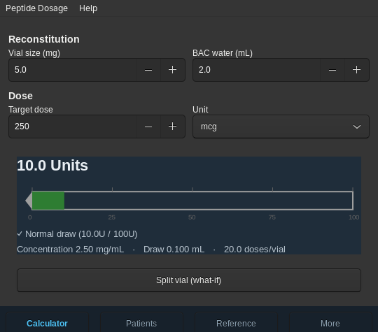
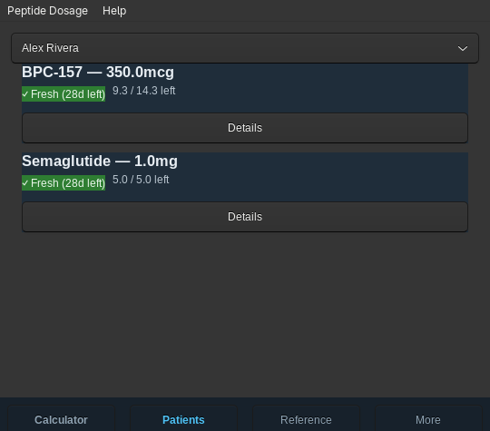
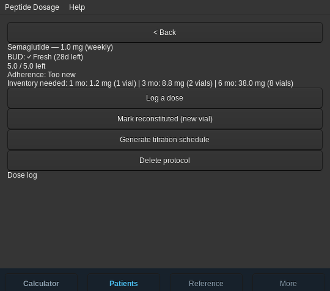
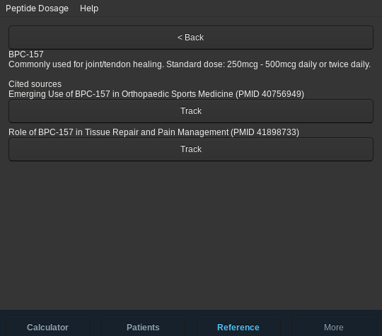

# Peptide Dosage (Toga port)

A cross-platform GUI port of [peptide-dosage-tui](https://github.com/alinuxfan/peptide-dosage-tui), built with **Python** and **[Toga](https://toga.readthedocs.io/)** (BeeWare) so the same reconstitution-dosing, patient-protocol, and literature-tracking tool runs on Android, macOS, Windows, and Linux instead of just the terminal.

Research/educational tool — not medical advice.

## Screenshots

| Calculator | Patients |
|---|---|
|  |  |

| Protocol Detail (with inventory projection) | Peptide Reference |
|---|---|
|  |  |

## Status

Early but usable. The Calculator, Patients (protocol list + detail, dose logging, titration schedule generator), Reference (peptide list + detail + PubMed literature tracking), and profile/export screens all work end-to-end.

### Supported platforms

| Platform | Package built by CI |
|---|---|
| Linux (Ubuntu 24.04 "noble" or newer) | `.deb` (Briefcase `system` format) |
| macOS | signed and notarized `.app` / `.dmg` |
| Windows | MSI installer |
| Android | signed APK (sideload) |

iOS / iPhone is **intentionally unsupported**: shipping there needs a paid Apple Developer account and App Store review that this project doesn't have set up.

### Install

Download the file for your platform from the [Releases page](../../releases) (each `v*` tag builds a draft release that the maintainer publishes after checking it):

- **Linux:** `sudo apt install ./peptide-dosage_*.deb`
- **macOS:** open the `.dmg` and drag the app to Applications.
- **Windows:** run the `.msi`. The installer is not yet code-signed, so SmartScreen may warn on first launch ("More info" -> "Run anyway").
- **Android:** copy the `.apk` to your phone and open it; you'll need to allow installing apps from your browser/file manager ("unknown sources"). The app needs only network access (for PubMed lookups).

Your data is stored locally in a SQLite database in the per-user app data folder; nothing is sent anywhere except PubMed queries you trigger.

## Architecture

`calc.py`, `db.py`, and `ncbi.py` are carried over from the TUI unchanged (pure logic, no UI dependency) — see that repo for the data model and formulas. Everything under `src/peptide_dosage/screens/`, `dialogs/`, `nav.py`, and `widgets/` is new: a hand-rolled bottom-tab-bar + push/pop navigation stack (Toga has no built-in mobile nav widget), since a phone-sized screen needed a different information architecture than the TUI's six tabs.

## Development

```bash
pip install briefcase
briefcase dev        # install deps + run
pytest tests/        # logic tests ported from the TUI
```

## CI and builds

Three GitHub Actions workflows live in `.github/workflows/`:

- **Test** (`test.yml`): runs `pytest tests/` on Ubuntu, Windows, and macOS (Python 3.12) for every PR and push to `master`.
- **Build check** (`build-check.yml`): for every PR and push to `master`, runs `briefcase create` + `briefcase build` for Linux (`system` format, Docker, `ubuntu:noble`), Windows (`app`), macOS (`app`), and Android (`gradle`), so packaging breakage is caught early. It doesn't package, sign, or use any secrets.
- **Release** (`release.yml`): on a `v*` tag, builds, packages, and signs all four platforms and attaches them to a draft GitHub Release.

To build locally, e.g. `briefcase create linux system --target ubuntu:noble && briefcase build linux system --target ubuntu:noble` (Docker required), or `briefcase create android gradle && briefcase build android gradle`. The app ID (`org.example.peptidedosage`) must not be changed, since it determines where user data is stored.

## License

MIT — see [LICENSE](LICENSE).
